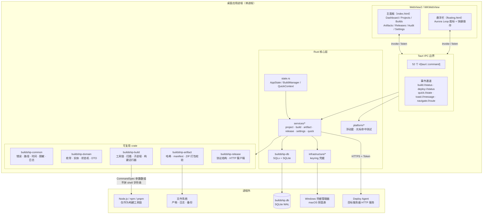
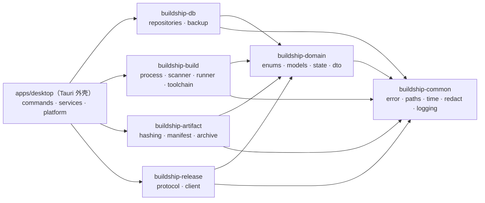
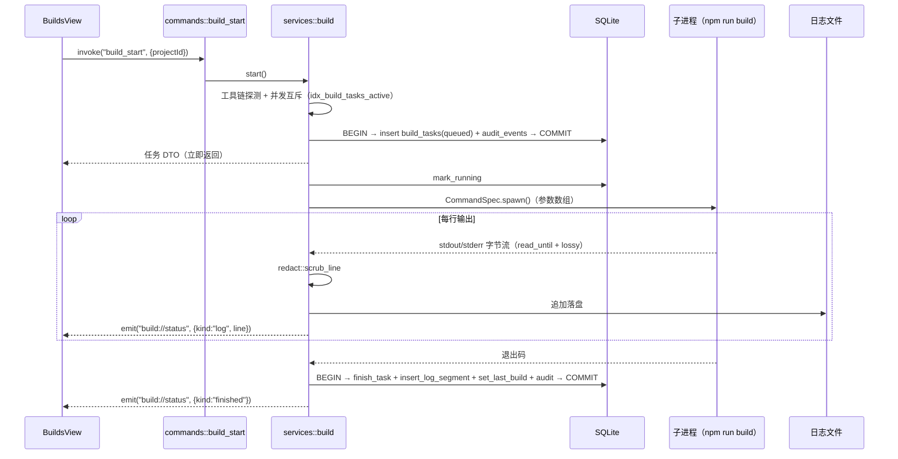
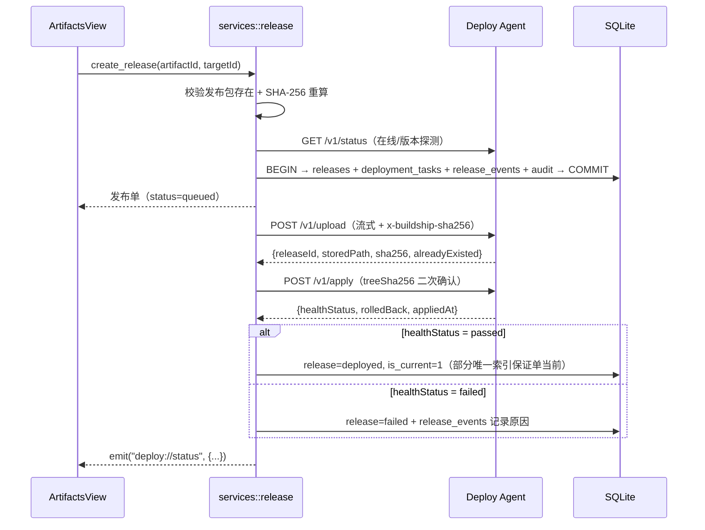
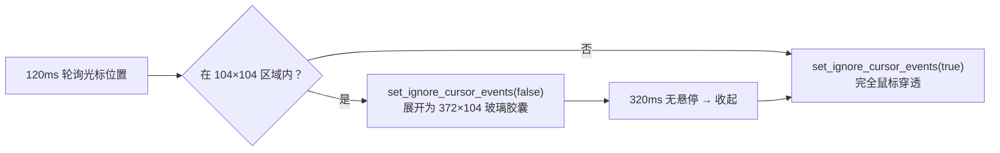

# Buildship 技术架构

> 版本：V1.0（对应开发方案 16 章"第一步"交付物之一）
> 技术栈：Tauri 2 + Rust + Vue 3 + TypeScript + SQLite

## 1. 总体结构

Buildship 是单机桌面应用，它把"本机构建"与"远程发布"两件事串成一条可审计的流水线。
渲染层只有视图与交互，所有系统能力（子进程、文件、数据库、凭据、网络）都在 Rust 侧。



### 关键约束（不可绕过）

| 约束 | 落地方式 |
| --- | --- |
| 前端不直连数据库、不执行命令 | 渲染层只能 `invoke` 白名单命令；capabilities 里没有 shell/fs 插件权限 |
| 构建进程不使用 shell 拼接 | `CommandSpec` 只接受参数数组，`validate_arg` 拒绝 `& \| < > ^ % ! " ' \`` 与换行 |
| 凭据不入库 | 库里只存 `secret_references`（provider + key），真值在 keyring |
| 审计不可篡改 | `audit_events` 上有 `BEFORE UPDATE/DELETE` 触发器，直接 `RAISE(ABORT)` |
| 状态流转受控 | 所有状态变更走 `buildship-domain::state` 校验，非法流转返回 `STATE_INVALID` |

## 2. 分层与依赖方向

依赖是单向的，`domain` 不认识 `db`，`db` 不认识 `services`。



`deploy-agent` 是独立二进制，只复用 `common + artifact + release`，不依赖 `db`，
因为服务器端不需要也不应该有桌面端数据库。

## 3. 模块边界

| 模块 | 职责 | 明确的"不做" |
| --- | --- | --- |
| `commands/*` | 参数反序列化、权限/状态前置校验、调用 service、返回 DTO | 不写业务规则、不直接拼 SQL |
| `services/project` | 只读扫描、slug 唯一化、增删改、构建配置 | 不启动构建 |
| `services/build` | 工具链前置检查、并发互斥、事务建任务、spawn 执行、日志落盘与事件推送 | 不打包 |
| `services/artifact` | 校验产物目录、调用打包、事务写库、删除保护（被发布引用则拒绝） | 不发版 |
| `services/release` | 环境/目标 CRUD、连通性检测、建 Release + Deployment、推进状态机、回滚 | 不打包 |
| `services/settings` | 设置读写、备份/恢复、凭据元数据 | 不存明文密钥 |
| `buildship-build::process` | 参数白名单、PATHEXT 解析、整树终止 | 不做业务编排 |
| `buildship-build::runner` | 流式读取、GBK 容错、脱敏、双通道输出 | 不判断成功语义（由退出码决定） |
| `buildship-artifact::archive` | 排除规则、ZIP + manifest、SHA-256、校验 | 不做上传 |
| `buildship-release::client` | 协议头、流式上传、错误码映射 | 不含重试策略（由 service 决定） |
| `deploy-agent` | 接包、校验、解压、原子切换、健康检查、审计 | 不构建、不接触桌面数据库 |

## 4. 仓库目录设计

```text
buildship/
├── Cargo.toml                     # workspace 根，统一依赖版本
├── crates/
│   ├── buildship-common/          # 错误码、路径、时间、脱敏、日志
│   ├── buildship-domain/          # 枚举、实体、状态机、DTO
│   ├── buildship-db/              # SQLx、migrations、repositories、备份
│   ├── buildship-build/           # 工具链探测、项目扫描、进程执行
│   ├── buildship-artifact/        # 哈希、manifest、ZIP 打包与校验
│   └── buildship-release/         # Agent 协议结构 + HTTP 客户端
├── apps/desktop/
│   ├── src-tauri/                 # 桌面端 Rust 外壳（commands/services/platform）
│   ├── src/                       # Vue 3 渲染层
│   │   ├── views/                 # 7 个页面
│   │   ├── stores/                # Pinia（setup store）
│   │   ├── floating/              # 悬浮栏独立入口
│   │   ├── components/            # AppShell / AuroraMark / StatusPill …
│   │   ├── composables/           # useIpc / useFormat
│   │   └── types/ipc.ts           # 与 Rust DTO 一一对应的类型
│   ├── index.html                 # 主面板入口
│   └── floating.html              # 悬浮栏入口
├── deploy-agent/                  # 目标服务器发布代理（独立二进制）
├── docs/                          # 本目录
├── scripts/                       # 图标生成等辅助脚本
└── .github/workflows/             # CI（Windows + macOS 构建与测试）
```

## 5. 关键数据流

### 5.1 构建



### 5.2 发布



### 5.3 悬浮栏



## 6. 窗口与运行形态

| 窗口 | label | 尺寸 | 特性 |
| --- | --- | --- | --- |
| 主面板 | `main` | 1320×860（最小 1080×720） | 关闭时收进托盘，不退出进程 |
| 悬浮栏 | `floating` | 104×104 ↔ 372×104 | 无边框、透明、置顶、不进任务栏、可拖动 |

托盘菜单：显示主面板 / 构建当前项目 / 退出。

## 7. 未完成与已知限制

| 项 | 状态 | 说明 |
| --- | --- | --- |
| macOS 实机验收 | 未完成 | 代码已按 `cfg(target_os)` 分支实现（WKWebView、apple-native keyring、点击穿透降级为不穿透），但本机无 Mac，**不得标记为已验收** |
| 多站点并行发布 | 已限制 | 同一目标同时只允许一个部署任务（服务端站点锁 + 桌面端状态机） |
| Agent HTTPS | 由部署方负责 | Agent 本身只监听 HTTP，TLS 终止建议交给前置 nginx/IIS |
| 增量/断点上传 | 未实现 | 当前整包上传，靠 Agent 侧 `alreadyExisted` 幂等复用 |
