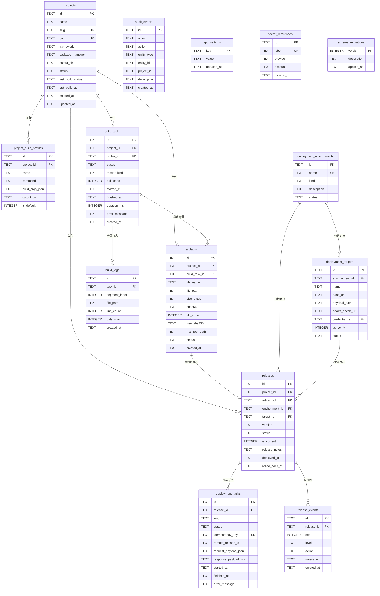
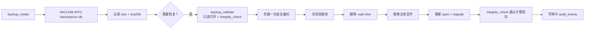

# 数据库设计（SQLite）

> 对应方案 5 章与 16 章"第一步"：14 张核心表在初始 migration 中一次性建立，不推迟。
> 迁移文件：`crates/buildship-db/migrations/0001_init.sql`

## 1. 连接与运行参数

| 参数 | 值 | 原因 |
| --- | --- | --- |
| `journal_mode` | `WAL` | 读写并发，构建写日志时界面仍可查询 |
| `foreign_keys` | `ON` | 每个连接都要开，否则约束不生效 |
| `busy_timeout` | `5000ms` | 构建线程与界面并发写入时自动等待 |
| `synchronous` | `NORMAL` | WAL 下的性能/安全折中 |
| 迁移 | `sqlx::migrate!` 编译期内嵌 | 安装包不依赖外部 SQL 文件 |

`Db::open` 完成后立即执行 `integrity_check`（含 `foreign_key_check`），
打开即校验，避免带着损坏的库继续跑。

## 2. ER 图



## 3. 业务约束如何落到数据库

单靠应用层校验不够，关键不变量用**部分唯一索引**锁死，任何绕过 service 的写入都会被拒绝。

| 不变量 | 实现 |
| --- | --- |
| 同一项目同时只能有一个排队/运行中的构建 | `idx_build_tasks_active ON build_tasks(project_id) WHERE status IN ('queued','running')` |
| 同一项目+环境只能有一个"当前版本" | `idx_releases_current ON releases(project_id, environment_id) WHERE is_current = 1` |
| 同一项目只能有一个默认构建配置 | `idx_profiles_default ON project_build_profiles(project_id) WHERE is_default = 1` |
| 项目 slug / 路径唯一 | `idx_projects_slug`、`idx_projects_path` |
| 发布版本号在项目+环境内唯一 | `idx_releases_version` |
| 部署任务幂等 | `idx_deploy_tasks_idempotency ON deployment_tasks(idempotency_key)` |
| 事件流序号连续且唯一 | `idx_release_events_seq ON release_events(release_id, seq)` |

事件序号由单条 SQL 原子生成，避免并发下的读-改-写竞态：

```sql
INSERT INTO release_events (id, release_id, seq, level, action, message, created_at)
SELECT ?1, ?2, COALESCE(MAX(seq), 0) + 1, ?3, ?4, ?5, ?6
FROM release_events WHERE release_id = ?2;
```

## 4. 审计不可篡改

```sql
CREATE TRIGGER trg_audit_events_no_update
BEFORE UPDATE ON audit_events
BEGIN
    SELECT RAISE(ABORT, 'audit_events 只允许追加，不允许修改');
END;

CREATE TRIGGER trg_audit_events_no_delete
BEFORE DELETE ON audit_events
BEGIN
    SELECT RAISE(ABORT, 'audit_events 只允许追加，不允许删除');
END;
```

删除项目时审计记录必须保留，因此 `audit_events.project_id` 不使用外键级联。

## 5. 时间与序列化约定

- 所有时间列存 **UTC RFC3339 毫秒**字符串（`buildship_common::time::to_db`），
  展示层负责转本地时区，避免"存在库里的时间随机器时区漂移"。
- Rust 实体用 `#[serde(rename_all = "camelCase")]`，与 TS 类型一一对应。
- 枚举以 `snake_case` 字符串落库，与 `sqlx::Type` 派生保持一致；
  升级只增不改，历史值始终可读。

## 6. 备份与恢复



用 `VACUUM INTO` 而不是直接复制文件：WAL 模式下直接拷贝可能拿到未合并的中间态。

## 7. 迁移策略

- 迁移编号连续：`0001_init.sql`、`0002_xxx.sql`……
- 只允许**新增**表/列/索引；破坏性变更必须新表 + 数据搬迁 + 改名，且单独评审。
- `schema_migrations` 是 `_sqlx_migrations` 的可读镜像（`version / description / applied_at`），供运维与"关于"页展示。
- 迁移在事务中执行，失败即回滚并让启动阶段直接报错，不带病运行。
