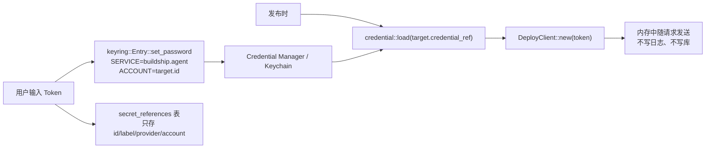

# 安全设计

> 对应方案 12 章。原则：**默认拒绝、最小权限、凭据不落库、动作可审计**。

## 1. 威胁模型

| 威胁 | 场景 | 缓解措施 |
| --- | --- | --- |
| 恶意项目脚本 | 用户添加来路不明的项目，`postinstall` 执行任意代码 | 构建命令来自用户显式配置的脚本名；首启展示工具链与命令预览；日志全程落盘可回溯 |
| 命令注入 | 项目名/分支名/路径拼接进 shell | `CommandSpec` 只接受参数数组，`validate_arg` 拒绝 `& \| < > ^ % ! " ' \`` 与换行 |
| 越权读写任意文件 | 前端或被篡改的前端调用 fs | capabilities 不含 `fs:*`；所有路径参数在 Rust 侧规范化并做根目录约束 |
| 发布包投毒 | 中间人替换 ZIP | 上传前后双算 SHA-256；`manifest.json` 逐文件比对；`tree_sha256` 二次确认 |
| zip-slip | 包含 `../../windows/system32` 条目 | Agent 用 `enclosed_name()` 过滤，非法条目直接拒绝整包 |
| 压缩炸弹 | 极小包解压出 TB 级数据 | 单条目 512MB、总量 8GB、条目数 20 万三重上限 |
| 凭据泄露 | 数据库/日志/备份被拷走 | Token 存系统凭据管理器；库内只有 `secret_references` 引用；日志按行脱敏 |
| 审计被篡改 | 事后修改操作记录 | `audit_events` 上 `BEFORE UPDATE/DELETE` 触发器 `RAISE(ABORT)` |
| Agent 被任意客户端调用 | Agent 直接暴露公网 | Token 固定时间比较 + 站点与物理路径白名单 + 建议反代限制来源 IP |
| 悬浮栏挡住鼠标 | 置顶透明窗覆盖其他应用 | 120ms 热区轮询，区域外 `set_ignore_cursor_events(true)` 完全穿透 |

## 2. 子进程执行

```rust
// crates/buildship-build/src/process.rs
pub fn validate_arg(arg: &str) -> Result<(), AppError> {
    // 这些字符在 cmd.exe 下具备拼接/展开语义，一律拒绝
    const FORBIDDEN: &[char] = &['&', '|', '<', '>', '^', '%', '!', '"', '\'', '`'];
    ...
}

pub struct CommandSpec {
    pub program: PathBuf,   // 已按 PATHEXT 解析出的绝对路径
    pub args: Vec<String>,  // 逐元素传入，从不拼接成字符串
    pub cwd: PathBuf,
    pub env: Vec<(String, String)>,
}
```

要点：

1. **从不拼接 shell 字符串**。`to_spawn()` 直接 `Command::new(program).args(args)`。
2. `.cmd` / `.bat` 必须经 `cmd.exe /d /c` 调用（Windows 上无法直接 exec），
   此时传入的是**数组**而非单串，且参数已过白名单，`/d` 关闭 AutoRun。
3. Windows 上 `CREATE_NO_WINDOW`，避免每次构建弹黑框。
4. env 不继承全部父进程变量，只透传 `PATH`、`SystemRoot`、`APPDATA` 等必需项。
5. 取消时按进程树终止：Windows `taskkill /T /F`，Unix `kill(-pid)`；
   避免 `npm run build` 的子进程（vite/rollup）成为僵尸继续写产物。

## 3. 凭据管理



- `secret_list` 返回**引用元数据**，不返回明文；前端只能看到"已配置/未配置"。
- 覆盖写入同名 label 即轮换；删除目标时提示是否同时删除凭据。
- 日志脱敏覆盖三种形态：`token=xxx`、`--token xxx`、`Authorization: Bearer xxx`。

## 4. 日志脱敏

```rust
// buildship-common/src/redact.rs
pub fn scrub_line(line: &str) -> String
```

按字符扫描的状态机，识别 `key=value`、`key: value`、`--flag value` 三种形态，
命中敏感键名（`token`、`secret`、`password`、`key`、`credential`、`authorization`、
`x-buildship-token` 等）时把值替换为 `***`。

单测覆盖：`token=abc` `"password": "x"` `--token abc` `Authorization: Bearer abc`
以及"非敏感键不受影响"。

## 5. WebView 安全

| 项 | 配置 |
| --- | --- |
| CSP | `default-src 'self'; img-src 'self' data:; style-src 'self' 'unsafe-inline'; connect-src 'self' ipc: http://ipc.localhost` |
| 远程内容 | 不加载任何远程脚本/字体/CDN，全部本地打包 |
| 导航 | 应用内不提供任意 URL 跳转；外链走系统浏览器（`opener` 插件，仅 `open-path`） |
| 前端权限 | 无 shell / fs / http 插件权限 |
| 消息校验 | 所有 `invoke` 参数在 Rust 侧再做一次类型与范围校验（不信任前端） |

## 6. Agent 侧

| 措施 | 实现 |
| --- | --- |
| 认证 | `x-buildship-token`，SHA-256 后逐字节异或比较（固定时间） |
| 协议版本 | 显式版本不匹配 → 400，避免半成功 |
| 路径白名单 | `physicalPath` 必须与配置的站点根目录**逐段相等**，否则 403 |
| releaseId 过滤 | 仅 `[A-Za-z0-9._-]{1,128}`，拒绝 `.` / `..` |
| 原子切换 | 先建 `current.next` 再两步改名；删除 `current` 只摘链接，不递归目标 |
| 健康检查失败 | 自动回滚到上一版本；无版本可回则返回 502 |
| 审计 | `.buildship/audit.jsonl` 追加 + `flush`，记录来源 IP、requestId、结果 |
| 上传上限 | `maxUploadMb`（默认 2048），超限断开 |

## 7. 数据保护

- 数据库文件位于用户数据目录，权限继承系统用户（Windows 上仅当前用户）。
- 备份文件同样是完整数据库副本，**含敏感元数据但不含明文凭据**。
- 恢复流程先做一次安全备份，避免"恢复错文件导致数据不可回退"。
- 删除项目是软删除（`status=archived`），物理清理需要显式操作且写审计。

## 8. 未覆盖的风险（明确声明）

| 风险 | 说明 | 建议 |
| --- | --- | --- |
| 项目自身脚本的任意代码执行 | 构建过程本质就是执行项目代码 | 只在可信项目上使用；构建日志全程留痕；不要以管理员身份运行 Buildship |
| Agent 明文 HTTP | 默认不内置 TLS | 生产必须前置 HTTPS 反代并限制来源 |
| 本机恶意进程读取内存 | 无法防御同用户权限的进程 | 依赖操作系统账户隔离 |
| 供应链（npm 依赖） | 安装包未锁定 | 已提交 `package-lock.json`，CI 用 `npm ci` |
